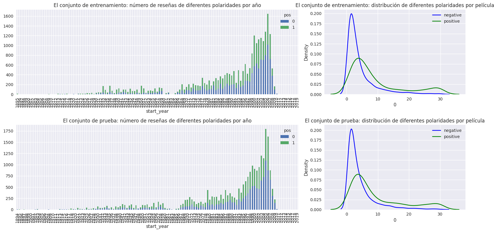
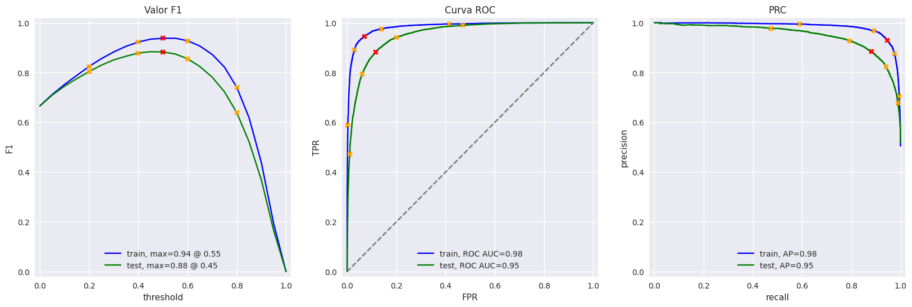

# Clasificación de reseñas de películas con NLP — Film Junky Union

Proyecto de procesamiento de lenguaje natural del bootcamp de Ciencia de Datos de TripleTen.

## Problema de negocio

Film Junky Union, una comunidad de aficionados al cine clásico, está desarrollando un sistema para filtrar y categorizar reseñas. El objetivo es entrenar un modelo que **detecte automáticamente las reseñas negativas**, con un **valor F1 de al menos 0,85**.

## Datos

- Reseñas de películas de IMDB etiquetadas como positivas o negativas.
- Conjunto balanceado: 23.715 reseñas positivas y 23.616 negativas.

## Metodología

1. **Análisis exploratorio**: número de reseñas por año, distribución de calificaciones y balance de clases en entrenamiento y prueba.
2. **Normalización del texto**: minúsculas y eliminación de dígitos y signos de puntuación.
3. **Vectorización con varias configuraciones**:
   - TF-IDF con lematización de **NLTK** y eliminación de *stopwords*.
   - TF-IDF con lematización de **spaCy**.
   - *Embeddings* de **BERT** (en una muestra reducida, por costo computacional).
4. **Clasificadores**: modelo constante (línea base), regresión logística y LightGBM.
5. **Evaluación** con F1, exactitud, ROC-AUC y APS, y prueba con reseñas escritas a mano.

## Resultados

| Modelo | Representación del texto | Clasificador | F1 (prueba) |
|---|---|---|---|
| Modelo 0 | Constante | DummyClassifier | Línea base |
| Modelo 1 | TF-IDF + NLTK | Regresión logística | **0,88** |
| Modelo 3 | TF-IDF + spaCy | Regresión logística | **0,88** |
| Modelo 4 | TF-IDF + spaCy | LightGBM | 0,86 |
| Modelo 9 | BERT (muestra) | Regresión logística | 0,76 |

## Gráficas

**Análisis exploratorio: reseñas por año y polaridad en entrenamiento y prueba**

**Evaluación del modelo TF-IDF + NLTK + regresión logística (F1, ROC y PRC)**

## Conclusiones

- Los modelos con TF-IDF y regresión logística superan el umbral de 0,85 y son rápidos de entrenar.
- **Modelo recomendado: regresión logística con lematización NLTK**, por su mejor balance entre desempeño y costo computacional.
- La lematización con spaCy no mostró diferencias significativas frente a NLTK.
- BERT exige recursos de cómputo mucho mayores. Con la muestra reducida no alcanzó el umbral.
- Las reseñas con ironía, sarcasmo o lenguaje ambiguo siguen siendo una fuente de error.

## Herramientas

Python · pandas · NumPy · Matplotlib · seaborn · scikit-learn · NLTK · spaCy · LightGBM · PyTorch · Transformers (BERT)

## Archivos

- [`filmjunky_clasificacion_resenas_nlp.ipynb`](filmjunky_clasificacion_resenas_nlp.ipynb): notebook completo con código, gráficos y análisis.
- `requirements.txt`: librerías utilizadas.

Los datos fueron proporcionados por TripleTen y no se incluyen en el repositorio. El notebook conserva las salidas de la ejecución original.

---

**Iván Ricardo Navarro Espinosa** — Ingeniero Químico, MSc · [GitHub](https://github.com/ivanrnavarro) · ivanrnavarro@gmail.com
Más proyectos del bootcamp en [tripleten-ciencia-de-datos](https://github.com/ivanrnavarro/tripleten-ciencia-de-datos).
